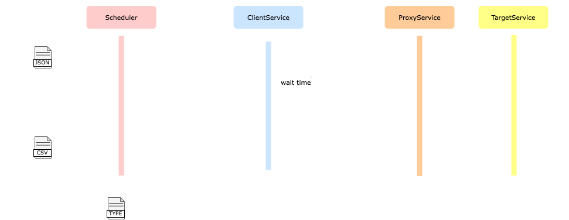

# ResilienceBench Documentation

Jump to:

* [Architectural overview](#architectural-overview)

* [Configuring test scenarios](#test-scenarios)

* [Understanding the test results](#test-results)

## Architectural overview

The ResilienceBench architecture comprises four main services: a **scheduler**, a **client service**, a **proxy service**, and a **target service**, which interact at run time as depicted in the diagram below. 

<br/><br/>

<br/><br/>

The scheduler (i) parses and executes the set of resilience test scenarios specified by the ResilienceBench user in a [JSON input file](#test-scenarios); (ii) invokes the client service with the test parameters for each scenario; and (iii) collects the test results received from the client service and returns them to the user as set of [CSV files](#test-results). The scheduler is implemented in Python, being the only native service of ResilienceBench.

The client service (i) invokes the target service using a given resilience pattern (e.g., Retry), as specified in the test scenario being executed; (ii) collects and calculates a set of performance and resilience metrics (e.g., mean response timefrom the result of each target service invocation; and (iii) returns the collected performance metrics to the scheduler. The client service can be implemented in any language supporting the use of resiliency patterns during the invocation of remote services. Currently, ResilienceBench includes two versions of the client service: one implemented in C\#, using the [Polly](https://github.com/App-vNext/Polly) resilience library, and the other implemented in Java, using the [Resilience4j](https://github.com/resilience4j/resilience4j) resilience library. Both versions support the use of the [Retry](https://docs.microsoft.com/en-us/azure/architecture/patterns/retry) and [Circuit Breaker](https://docs.microsoft.com/en-us/azure/architecture/patterns/circuit-breaker) patterns, in their basic configurations.

The proxy service transparently injects a given type of failure (e.g., abort or delay failures) into the target service invocation flow, according to a given failure rate. Any intermediary HTTP service capable of injecting faults into an HTTP invocation stream can be used as the proxy service. Currently, ResilienceBench uses [Envoy](https://www.envoyproxy.io/) as its proxy service.

Finally, the target service simply processess and responds to the client service's requests. Any service that responds to HTTP requests can be used as the target service. Currently, ResilienceBench uses [httpbin](https://github.com/postmanlabs/httpbin) as its target service.

At run time, the scheduler and the client service are deployed into two separate Docker containers, while the proxy service and the target service are deployed jointly, in a single containter (see the architecture diagram above). ResilienceBench uses [Vagrant](https://www.vagrantup.com/intro) to configure and create the environment's host machine, and [Docker Compose](https://docs.docker.com/compose/) to build, configure, and execute the environment's service containers.

## Test scenarios

A ResilienceBench test scenario consists of a test session in which the client service continuously invokes the target service, using a given resilience strategy, until a given number of successful invocations, or a given number of total (either successful or unsuccessful) invocations, is reached. During the test session, the target service may fail according to a given failure rate, which may cause the client service to immediately re-invoke the target service, wait for while before re-invoking the target service, or simply abort the invocation, depending on the resilience strategy used. Therefore, the resilience strategy used by the client service will directly affect its behavior upon failures of the target service, which, in turn, may have a direct impact on its performance metrics, such as total execution time and contention rate (see the [test results documentation](#test-results) for the full list of performance metrics currently supported by ResilienceBench).

ResilienceBench test scenarios are specified as a JSON file containing a number of **control** and **resilience** parameters. The JSON code below shows an example of a test scenario specification:

```json
   1  {
   2      "testId": "MyTest",
   3      "users": [25, 50, 100],
   4      "rounds": 10,
   5      "maxRequests": 100,
   6      "succRequests": 25,
   7      "targetUrl": "http://server:9211/bytes/1000",
   8      "fault": {
   9          "type": "abort",
  10          "percentage": [25, 50, 75],
  11          "status": 503
  12      },
  13      "clientSpecs": [
  14          {
  15              "strategy": "retry",
  16              "platform": "java",
  17              "lib": "resilience4j",
  18              "url": "http://resilience4j/retry",
  19              "patternConfig": {
  20                  "maxAttempts": 6,
  21                  "multiplier": 1.5,
  22                  "intervalFunction": "EXPONENTIAL_BACKOFF",
  23                  "initialIntervalMillis": [100, 200]
  24              }
  25          }
  26      ]
  27  }
```

In this example, lines 2-12 contain the control parameters, while lines 13-26 contain the resilience parameters. Note how some parameters are defined as an array of values, e.g., `concurrentUsers` (line 3). At scenario execution time, these values will be expanded by the scheduler to generate multiple scenario specifications containing each individual value of the array. In the example above, the scheduler will generate three different scenario specifications based on the three values provided for the `concurrentUsers` parameter, with the `concurrentUsers` parameter of each specification containing the values 25, 50, and 100, respectively. A similar expansion will occur with the values of the array-like parameters in line 10 (`percentage` attribute of the `fault` parameter, also with three values) and line 23 (`initialIntervalMilli` attribute of the `patternConfig` parameter, with two values). Overall, the scheduler will generate and execute 18 (3 × 3 × 2) distinct test scenarios from the above JSON file. 

### Control parameters

These parameters are used to control the test scenarios execution. 

| Parameter | Type | Required | Description |
| :--- | :--- | :--- | :--- |
| testId | `string` | no | The test identifier. If not defined, a test identifier will be automatically generated containing the date and time of the test execution. The test identifier is used as the name of the CSV file to be generated containing the test results. |
| users | `array of numbers` |  yes | Array containing the numbers of instances of the client service that will concurrently invoke the target service during each scenario execution. Each element of the array represents a different test scenario. |
| rounds | `number` | yes | Number of executions of each scenario. |
| succRequests | `number` | yes | Expected number of successful invocations of the target service by the client service. |
| maxRequests | `number` | yes | Maximum number of (either successful or unsuccessful) invocations of the target service by the client service. |
| targetUrl | `string` | yes | The target service URL. |
| fault | `faultSpec` | yes | Specification of the failure type to be injected by the proxy service into the target service invocation flow. See the faultSpec scheme below |

The latter parameter is useful to prevent the client application from never reaching the required number of successful invocations in a reasonable window of time, which may happen under high server failure rates.

#### FaultSpec

| Parameter | Type | Required | Description |
| :--- | :--- | :--- | :--- |
| type | `string` | yes | Type of failure to be injected. Currently supported types: *delay* and *abort*. |
| percentage | `array of numbers` | yes | Array containing the percentages of failures to be injected by the proxy service into the target service invocation flow. Each element of the array represents a different test scenario. 
| duration | `number` | no | Duration (in miliseconds) of the delay failures to injected by the proxy service. Required when type is *delay*. |
| status | `number` | no | HTTP status code to be returned by the proxy service to the client service upon each failed invocation. Required when type is *abort*. |
| windows | `array of windows` | no | Time windows during which the failure is injected. When present, `percentage` applies only inside the windows and no failures are injected outside them. When omitted, failures are injected throughout the whole scenario. See [Time-window failures](#time-window-failures). |
| repeat | `boolean` | no | When `true`, the list of `windows` starts over after its last window until the scenario ends. When `false` or omitted, the windows happen once. Requires `windows`. |

#### Time-window failures

By default, each request fails independently with the given `percentage` probability for the whole scenario. To instead simulate an outage, such as the target service returning 503 for 5 seconds and then working as usual, add a `windows` list to the fault specification:

```json
"fault": {
    "type": "abort",
    "status": 503,
    "percentage": [100],
    "windows": [
        { "start": 2000, "duration": 5000 },
        { "start": 8000, "duration": 5000 }
    ]
}
```

Each window has a `start` and a `duration`, both in milliseconds. `start` is how long the service works normally before the window: the first window's `start` counts from the beginning of the scenario execution (every round starts its own clock), and each following window's `start` counts from the end of the previous window. In the example above, the service works for 2 s, fails for 5 s, works for 8 s, fails for 5 s, and then works until the scenario ends. Inside a window, the proxy service fails `percentage` percent of the requests (use `100` for a full outage). Outside the windows, no failures are injected. Delay failures work the same way. See [samples/config-abort-windows.json](../samples/config-abort-windows.json) for a complete example.

By default, the windows happen once. To make the service alternate between working and failing for the whole scenario, set `repeat` to `true`: after the last window, the list starts over, and its first `start` counts from the end of the last window. For example, to have the service work for 10 s and then fail for 5 s, over and over:

```json
"fault": {
    "type": "abort",
    "status": 503,
    "percentage": [100],
    "windows": [
        { "start": 10000, "duration": 5000 }
    ],
    "repeat": true
}
```

A scenario still ends when `succRequests` or `maxRequests` is reached, so it must last longer than the end of its last window, otherwise later windows never happen. With `repeat`, the scenario usually ends partway through a cycle, and it must last at least one pass through the list. The clients invoke the target service in a tight loop: a successful request takes a few milliseconds, and a request aborted by the proxy takes well under one millisecond, so size `succRequests` so that the scenario outlasts the windows, and `maxRequests` so that the failures during the windows do not exhaust it. The `faultWindowsStarted`, `faultWindowsCompleted` and `scenarioDurationMs` result columns show whether each scenario covered all windows, and the scheduler logs a warning when it did not finish the list once.


### Resilience parameters

These parameters are used to configure the client service and the resilience strategy it will use to invoke the target service. 

| Parameter | Type | Required | Description |
| :--- | :--- | :--- | :--- |
| strategy | `string` | yes | The name of the resilience strategy to be used by the cliente service. Currently supported strategies: *retry* (Retry pattern), *circuit_breaker* (Circuit Breaker pattern), and *baseline* (no resilience pattern).|
| platform | `string` | yes | The name of the language/plataform where the client service was implemented. Currently supported platforms: *dotnet* (.NET), and *java* (Java).|
| lib | `string` | yes | The name of the resilience library used by the client service. Currently supported libraries: *polly* ([Polly](https://github.com/App-vNext/Polly), in the .NET platform), and *resilience4j* ([Resiliency4](https://github.com/resilience4j/resilience4j), in the Java platform).|
| url | `string` | yes | The url where the client service is deployed. |
| patternConfig | `object` | yes | The set of configuration paramaters used by the client service to instantiate the given resilience pattern using the given resilience library. The names of these parameters should match the names of the corresponding configuration parameters used by the given resilience library with the given resilience pattern. |

## Test results

After all test scenarios have been executed, the test results are stored as a set of CSV files in the location specified by the user in the ResilienceBench's docker-compose file. Each CSV file contains the same initial set of columns corresponding to the set of metrics collected during the scenarios execution.

<table>
    <thead>
        <tr>
            <th>Metric</th>
            <th>Type</th>
            <th>Description</th>
        </tr>
    </thead>
    <tbody>
        <tr>
            <td>totalCalls</td>
            <td><code>number</code></td>
            <td>Total number of calls of the target service by the client service (excluding extra calls by the resiliency pattern)</td>
        </tr>
        <tr>
            <td>successfulCalls</td>
            <td><code>number</code></td>
            <td>Number of successful calls of the target service by the client service (excluding extra calls by the resiliency pattern)</td>
        </tr>
        <tr>
            <td>unsuccessfulCalls</td>
            <td><code>number</code></td>
            <td>Number of unsuccessful calls of the target service by the client service (excluding extra calls by the resiliency pattern)</td>
        </tr>
        <tr>
            <td>totalRequests</td>
            <td><code>number</code></td>
            <td>Total number of calls of the target service by the client service (including extra calls by the resiliency pattern)</td>
        </tr>
        <tr>
            <td>successfulRequests</td>
            <td><code>number</code></td>
            <td>Number of successful calls of the target service by the client service (including extra calls by the resiliency pattern)</td>
        </tr>
        <tr>
            <td>unsuccessfulRequests</td>
            <td><code>number</code></td>
            <td>Number of unsuccessful calls of the target service by the client service (including extra calls by the resiliency pattern)</td>
        </tr>
        <tr>
            <td>successTime</td>
            <td><code>number</code></td>
            <td>Total accumulated time waiting for successful responses from the target service by the client service</td>
        </tr>
        <tr>
            <td>successTimePerRequest</td>
            <td><code>number</code></td>
            <td>Average amount of time waiting for successful responses from the target service by the client service</td>
        </tr>
        <tr>
            <td>errorTime</td>
            <td><code>number</code></td>
            <td>Total accumulated time waiting for unsuccessful responses from the target service by the client service</td>
        </tr>
         <tr>
            <td>errorTimePerRequest</td>
            <td><code>number</code></td>
            <td>Average amount of time waiting for unsuccessful responses from the target service by the client service</td>
        </tr>
        <tr>
            <td>totalExecutionTime</td>
            <td><code>number</code></td>
            <td>Total execution time of the client service</td>
        </tr>
        <tr>
            <td>totalContentionTime</td>
            <td><code>number</code></td>
            <td>Total acumulated time waiting for either successful or unsuccessful responses from the target service by the client service</td>
        </tr>
        <tr>
            <td>contentionRate</td>
            <td><code>number</code></td>
            <td> totalContentionTime / totalExecutionTIme (fraction of the client servicen's total execution time waiting for either successful or unsuccessful responses from the target service)</td>
        </tr>
        <tr>
            <td>throughput</td>
            <td><code>number</code></td>
            <td>Number of calls of the target service by client service per milisecond</td>
        </tr>
        <tr>
            <td>startTime</td>
            <td><code>timestamp</code></td>
            <td>Start time of the client service execution</td>
        </tr>
        <tr>
            <td>endTime</td>
            <td><code>timestamp</code></td>
            <td>End time of the client service execution</td>
        </tr>
    </tbody>
</table>

Each CSV file also contains an additional set columns corresponding to the control and resilience test parameters used during the scenarios execution. 

<table>
    <thead>
        <tr>
            <th>Parameter</th>
            <th>Type</th>
            <th>Description</th>
        </tr>
    </thead>
    <tbody>
        <tr>
            <td>userId</td>
            <td><code>number</code></td>
            <td>Unique numerical identifier of the client service instante (virtual user) that collected the metrics</td>
        </tr>
        <tr>
            <td>round</td>
            <td><code>number</code></td>
            <td>Unique numerical idenfier of the test round within which the client service metrics were collected</td>
        </tr>
        <tr>
            <td>users</td>
            <td><code>number</code></td>
            <td>Number of client service instances (virtual users) created during each test round</td>
        </tr>
        <tr>
            <td>lib</td>
            <td><code>string</code></td>
            <td>Name of the resilience library used by the client service</td>
        </tr>
        <tr>
            <td>strategy</td>
            <td><code>string</code></td>
            <td>Name of the resilience strategy used by the client service</td>
        </tr>
        <tr>
            <td>faultPercentage</td>
            <td><code>number</code></td>
            <td>Percentage of failures injected into the target service invocation stream by the proxy service</td>
        </tr>
        <tr>
            <td>faultType</td>
            <td><code>string</code></td>
            <td>Type of failure injected into the target service invocaiton stream by the proxy service</td>
        </tr>
        <tr>
            <td>faultStatus</td>
            <td><code>number</code></td>
            <td>HTTP status code returned to the client service by the proxy service upon failure</td>
        </tr>
        <tr>
            <td>faultWindows</td>
            <td><code>string</code></td>
            <td>JSON list of the failure time windows. Only present for time-window failures</td>
        </tr>
        <tr>
            <td>faultRepeat</td>
            <td><code>boolean</code></td>
            <td>Whether the list of failure time windows repeats until the scenario ends. Only present when <code>repeat</code> is set in the configuration</td>
        </tr>
        <tr>
            <td>faultWindowsStarted</td>
            <td><code>number</code></td>
            <td>Number of failure time windows that started before the scenario ended, counting every pass through the list when <code>repeat</code> is set. Only present for time-window failures</td>
        </tr>
        <tr>
            <td>faultWindowsCompleted</td>
            <td><code>number</code></td>
            <td>Number of failure time windows that ended before the scenario ended, counting every pass through the list when <code>repeat</code> is set. Only present for time-window failures</td>
        </tr>
        <tr>
            <td>scenarioDurationMs</td>
            <td><code>number</code></td>
            <td>Duration of the scenario execution (all users), in milliseconds, as measured by the scheduler. Only present for time-window failures</td>
        </tr>
    </tbody>
</table>

In addition to the parameters described above, each CSV file also contains the resilience parameters used to configure the particular resiliency pattern used by the client service. These parameters may vary according to resiliency pattern and the resilience library used, or may be ommitted if no resilency pattern was used. 

Alongside the CSV files, the raw [Envoy access log](https://www.envoyproxy.io/docs/envoy/latest/configuration/observability/access_log/usage#default-format-string) of each scenario group is stored as `accesslog_<group>.log` (e.g. `accesslog_f50u100.log` next to `results_f50u100.csv`), with one line per request received by the proxy service, without any aggregation. Each line has the request start time, the response status and flags (`FI` marks failures injected by the proxy) and the duration, which lets you analyze individual requests over time. Requests sent to the proxy before the test starts are not included. Access logs are collected when the scheduler's `ENVOY_ACCESS_LOG_PATH` points to the log file shared by the server through the `envoy-logs` volume, as in the provided docker-compose file.

By including both the collected metrics and the control and resilience parameters used during the tests, each result CSV file is self-contained and can be independently analyzed and visualized using any appropriate tool.  
